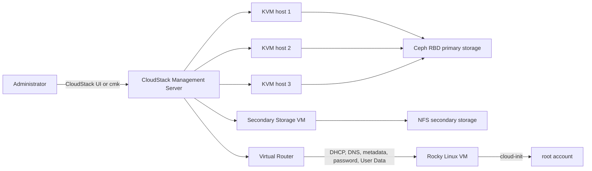

# Rocky Linux 9 template for Apache CloudStack 4.23 on KVM

A beginner-friendly, reproducible runbook for building a production-oriented Rocky Linux 9 template inside Apache CloudStack.

This guide follows a real Rocky Linux 9.8 build on Apache CloudStack 4.23.0.0 with KVM, Ceph RBD primary storage, NFS secondary storage, legacy BIOS, a 20 GiB XFS root disk, an isolated Virtual Router network, cloud-init, QEMU Guest Agent, and root SSH access by both password and public key.

The guide includes the failures encountered during the build and the fixes that worked. It intentionally does **not** include template deletion instructions.

## Target template

| Setting | Value |
|---|---|
| Guest OS | Rocky Linux 9.x Minimal |
| Cloud platform | Apache CloudStack 4.23 |
| Hypervisor | KVM |
| Architecture | x86_64 |
| Firmware | Legacy BIOS |
| Image format | QCOW2 |
| Default root disk | 20 GiB |
| Partitioning | GPT, BIOS boot partition, standard XFS root partition |
| LVM | No |
| Network | NetworkManager with DHCP |
| CloudStack datasource | Virtual Router; ConfigDrive retained as fallback |
| Primary build storage | Ceph RBD |
| Secondary storage | NFS in the tested environment |
| Guest agent | QEMU Guest Agent |
| Default login account | root |
| SSH authentication | Password and public key |
| SELinux | Enforcing |
| Firewall | firewalld enabled, SSH permitted |

> [!CAUTION]
> Direct root password SSH is intentionally enabled because it was a project requirement. Restrict TCP 22 to approved administrative CIDRs, use unique passwords, and prefer public keys for routine access. Read [SECURITY.md](SECURITY.md) before production use.

## What this guide proves

The tested workflow demonstrated that:

- Rocky Linux 9.8 boots on CloudStack KVM when the guest CPU exposes at least the x86-64-v2 baseline.
- A 20 GiB BIOS VM can be installed manually and turned into a QCOW2 CloudStack template.
- Cloud-init detects `DataSourceCloudStack` through an isolated network's Virtual Router.
- CloudStack-generated passwords and password reset work when `wget` is present in the guest.
- A caller-selected password can be set once through the CloudStack User Data panel.
- CloudStack SSH public-key injection can target root when root is the configured default cloud user.
- NetworkManager can retain a single clone-safe DHCP profile without a fixed IP or MAC address.
- QEMU Guest Agent, SELinux, firewalld, chrony, and XFS work in the resulting image.

The workflow did not have an NFS **primary** storage pool. NFS primary-storage validation therefore remains environment-specific. NFS secondary storage is not equivalent to NFS primary storage.

A dedicated admin-owned shared test network was also not provisioned during the build. The template should be validated on an approved shared network whose offering supplies DHCP, DNS, and User Data before production release.

## Repository layout

```text
.
├── README.md
├── SECURITY.md
├── docs/
│   ├── 01-prerequisites-and-discovery.md
│   ├── 02-iso-network-and-installation.md
│   ├── 03-guest-configuration.md
│   ├── 04-generalize-create-and-test.md
│   ├── 05-validation-matrix.md
│   └── troubleshooting.md
├── examples/
│   ├── 90-cloudstack.cfg
│   ├── 00-cloudstack.conf
│   └── user-data-set-root-password.sh
└── scripts/
    ├── collect-cloudstack-info.sh
    └── verify-rocky9-guest.sh
```

## Start here

Follow the chapters in order:

1. [Prerequisites and discovery](docs/01-prerequisites-and-discovery.md)
2. [ISO, network, and installation](docs/02-iso-network-and-installation.md)
3. [Guest configuration](docs/03-guest-configuration.md)
4. [Generalize, create, and test](docs/04-generalize-create-and-test.md)
5. [Validation matrix](docs/05-validation-matrix.md)
6. [Troubleshooting](docs/troubleshooting.md)

## Architecture



## The shortest successful path

The full documentation explains each action and its risks. The high-level path is:

1. Inventory CloudStack, KVM hosts, storage, network offerings, and OS types.
2. Verify every KVM host exposes an appropriate CPU model. Do not leave Rocky 9 guests on `qemu64`.
3. Download Rocky's checksum metadata and register the Minimal ISO privately with a `{SHA-256}` checksum.
4. Create a dedicated admin-owned isolated network with Virtual Router User Data, DHCP, DNS, Source NAT, firewall, and port forwarding.
5. Add explicit egress rules if the network uses default-deny egress.
6. Deploy a 2-vCPU, 4-GiB, 20-GiB BIOS builder VM from the ISO.
7. Install Rocky with a 1 MiB BIOS boot partition and one standard XFS root partition.
8. Update Rocky and install all required packages, especially `cloud-init`, `cloud-utils-growpart`, `qemu-guest-agent`, and `wget`.
9. Configure cloud-init, root SSH, firewalld, UTC, chrony, and one persistent DHCP profile.
10. Clean machine-specific identity and credentials, lock root, and power off without rebooting.
11. Create a private password-enabled template from the stopped root volume.
12. Deploy clean validation VMs for native password, User Data password, SSH key, resize, disk, reboot, recovery, host, network, and storage tests.
13. Publish only after every required validation row passes.

## Important lessons from the real build

### `qemu64` caused an early kernel panic

The installer kernel reached userspace, then terminated with an `Attempted to kill init` panic because the VM's generic CPU model did not expose Rocky 9's x86-64-v2 requirements. The corrected cluster setting was:

```properties
guest.cpu.mode=host-model
```

Apply a host-wide CPU change only after checking every host and understanding its effect on existing VMs and migration. See [Troubleshooting: Rocky kernel panic](docs/troubleshooting.md#rocky-9-panics-before-the-installer-appears).

### ISO deployment through the API needed both boot fields

A direct `deployVirtualMachine` call with only `boottype=BIOS` failed with a null boot-mode error. This environment required:

```text
boottype=BIOS
bootmode=Legacy
```

### Isolated network creation rejected `physicalnetworkid`

CloudStack selected the correct Guest physical network automatically. Passing `physicalnetworkid` to `createNetwork` failed because that parameter is accepted for Shared or L2 networks, not this isolated-network call.

### Default-deny egress blocked repository access

DHCP, the gateway, and DNS worked, but HTTPS timed out until explicit egress rules allowed TCP 443. The build network also allowed TCP 80, UDP 123, and ICMP for repository, time, and connectivity testing.

### Native password injection required `wget`

The critical failure was:

```text
FileNotFoundError: [Errno 2] No such file or directory: b'wget'
```

Rocky's packaged `DataSourceCloudStack` invoked `wget` to retrieve the generated password from the Virtual Router on port 8080. User Data worked while the generated password failed, which initially made the issue look like a root-user configuration problem. Installing and retaining `wget` fixed CloudStack password reset and native password injection.

### Rocky's module name used an underscore

The correct module entry in `/etc/cloud/cloud.cfg` was:

```yaml
- [set_passwords, always]
```

It was not `set-passwords`. Always inspect the packaged file before editing it.

## Source references

- [Apache CloudStack 4.23 documentation](https://docs.cloudstack.apache.org/en/latest/)
- [CloudStack: Working With Templates](https://docs.cloudstack.apache.org/en/latest/adminguide/templates.html)
- [CloudStack: User Data and Metadata](https://docs.cloudstack.apache.org/en/latest/adminguide/virtual_machines/user-data.html)
- [cloud-init: CloudStack datasource](https://cloudinit.readthedocs.io/en/stable/reference/datasources/cloudstack.html)
- [Rocky Linux cloud-init guide](https://docs.rockylinux.org/guides/virtualization/cloud-init/)
- [CloudStack issue: Rocky 9 on Ubuntu KVM hosts](https://github.com/apache/cloudstack/issues/8757)
- [cloud-init issue: early network initialization on RHEL](https://github.com/canonical/cloud-init/issues/4050)
- [cloud-init issue: CloudStack password handling](https://github.com/canonical/cloud-init/issues/5486)

Content derived from external documentation has been summarized and rephrased for licensing compliance. Consult the linked sources for authoritative updates.

## License

No license is selected by this guide. Add a license that matches your organization's publication policy before making the repository public.
